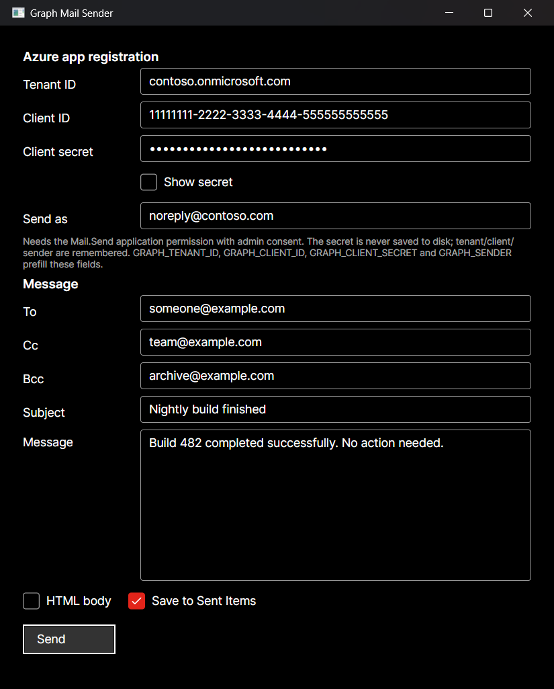
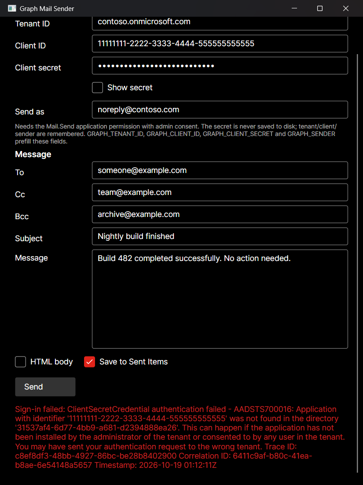

# Graph Mail Sender

[](https://github.com/Harlock123/GraphMailSender/actions/workflows/build.yml)
[](LICENSE)
[](https://dotnet.microsoft.com/)
[](https://avaloniaui.net/)
[](https://learn.microsoft.com/en-us/graph/api/user-sendmail)
[](https://avaloniaui.net/)

A small Avalonia desktop app (.NET 10) that sends a single email through the Microsoft Graph
API. You type the app-registration details, a recipient, a subject and a message, and it
`POST`s to `/users/{sender}/sendMail`.

Authentication is **app-only (client credentials)** — no interactive sign-in, no user context.



*Values shown are placeholders. `Send` stays disabled until every required field is valid.*

---

## Contents

- [Requirements](#requirements)
- [Build & run](#build--run)
- [Server-side setup](#server-side-setup) — the Entra/Exchange work, in order
- [Inputs](#inputs) — every field the app asks for
- [Settings and secrets](#settings-and-secrets)
- [Error reporting](#error-reporting)
- [Troubleshooting](#troubleshooting)
- [Project layout](#project-layout)

## Requirements

| | |
| --- | --- |
| **To build** | .NET 10 SDK |
| **To run** | Windows, macOS or Linux desktop |
| **Tenant** | A Microsoft Entra ID (Azure AD) tenant with Exchange Online |
| **Sender** | A **licensed Exchange Online mailbox**. On-premises mailboxes and unlicensed accounts cannot be used — Graph `sendMail` only reaches cloud mailboxes |
| **Permission to set it up** | An admin who can grant tenant-wide consent: **Global Administrator**, **Privileged Role Administrator**, or **Cloud Application Administrator** |
| **Network egress** | Outbound HTTPS (443) to `login.microsoftonline.com` and `graph.microsoft.com` |

## Build & run

```powershell
dotnet run --project src\GraphMailSender
```

## Server-side setup

All of this is one-time work in your tenant. Steps 1–3 are required; **step 4 is strongly
recommended** and explained below.

### 1. Register the application

1. **Entra admin center → Identity → Applications → App registrations → New registration.**
2. Give it any name. Under *Supported account types* choose **Accounts in this organizational
   directory only** unless you have a reason not to.
3. Leave **Redirect URI** empty — the client-credentials flow never redirects.
4. **Register**, then copy two values from the **Overview** page:
   - **Application (client) ID** → the app's *Client ID* field
   - **Directory (tenant) ID** → the app's *Tenant ID* field

### 2. Grant the Mail.Send application permission

1. **API permissions → Add a permission → Microsoft Graph.**
2. Choose **Application permissions** — *not* Delegated. Delegated `Mail.Send` requires a
   signed-in user and will fail in this app.
3. Select **`Mail.Send`** and add it.
4. Click **Grant admin consent for \<tenant\>** and confirm. Until the Status column shows a
   green check, every send returns `403 ErrorAccessDenied`.

### 3. Create a client secret

1. **Certificates & secrets → Client secrets → New client secret.**
2. Pick an expiry. Note that **Microsoft caps secrets at 24 months, and the portal default is
   180 days** — when it lapses, sends fail with `AADSTS7000222` and you must issue a new one.
   Put a calendar reminder somewhere.
3. Copy the **Value** column immediately — it is shown exactly once. The *Secret ID* is not
   the secret.

### 4. Restrict which mailboxes the app can send as

This matters. Application-level `Mail.Send` grants your app the ability to send as **every
mailbox in the tenant** — not just the one you typed in the form. An
[application access policy](https://learn.microsoft.com/en-us/graph/auth-limit-mailbox-access)
narrows that to a chosen set of mailboxes.

```powershell
Install-Module ExchangeOnlineManagement -Scope CurrentUser
Connect-ExchangeOnline -UserPrincipalName admin@contoso.onmicrosoft.com

# A mail-enabled security group holding only the mailboxes this app may send as
New-DistributionGroup -Name "GraphMailSenders" -Type Security `
  -Members noreply@contoso.com

New-ApplicationAccessPolicy `
  -AppId 11111111-2222-3333-4444-555555555555 `
  -PolicyScopeGroupId GraphMailSenders@contoso.com `
  -AccessRight RestrictAccess `
  -Description "Limit Graph Mail Sender to the noreply mailbox"
```

Verify it, remembering that a new policy can take **up to 30 minutes** to take effect:

```powershell
# Should report Granted for a mailbox in the group, Denied for one outside it
Test-ApplicationAccessPolicy -Identity noreply@contoso.com `
  -AppId 11111111-2222-3333-4444-555555555555
```

### Sending limits

Exchange Online throttles regardless of how the mail was submitted — roughly **30 messages per
minute** and **10,000 recipients per day** per mailbox. Exceeding it returns `429`. This app
sends one message at a time, so you will only meet these limits by driving it hard in a loop.

## Inputs

**Connection** — who the app signs in as:

| Field | What it is | Example |
| --- | --- | --- |
| Tenant ID | Directory (tenant) ID, or a verified domain | `contoso.onmicrosoft.com` |
| Client ID | Application (client) ID of the registration | `11111111-2222-…` |
| Client secret | The secret **Value** from Certificates & secrets | — |
| Send as | UPN or object ID of the sending mailbox; must be a licensed Exchange Online mailbox | `noreply@contoso.com` |

**Message** — what gets sent:

| Field | What it is |
| --- | --- |
| To | One or more addresses separated by comma, semicolon or whitespace. Duplicates are removed; each is validated before anything is sent |
| Cc | Optional carbon-copy addresses, same separators as To |
| Bcc | Optional blind-carbon-copy addresses, same separators as To. Other recipients cannot see these |
| Subject | Message subject. May be left empty |
| Message | Body text. Required |
| HTML body | Sends the body as `contentType: HTML` instead of `Text`. The box is a plain text editor either way — paste markup in yourself |
| Save to Sent Items | Whether Graph keeps a copy in the sender's Sent Items. On by default |

**Send** is disabled until Tenant ID, Client ID, Client secret, a valid *Send as* address, at
least one **To** recipient, and a non-empty body are all present. Subject, Cc and Bcc are
optional — a Cc or Bcc address alone will not satisfy the recipient requirement, and empty
Cc/Bcc fields are left out of the Graph request entirely rather than sent as empty arrays.
Every address across all three fields is validated before anything is sent.

## Settings and secrets

After a successful send, Tenant ID, Client ID and Send as are written to
`%APPDATA%\GraphMailSender\settings.json` (`~/.config` equivalents on macOS and Linux).

**The client secret is never written to disk.** Supply it per run, or from the environment.

All four can be prefilled from environment variables, which override the saved file:

```powershell
$env:GRAPH_TENANT_ID     = "contoso.onmicrosoft.com"
$env:GRAPH_CLIENT_ID     = "11111111-2222-3333-4444-555555555555"
$env:GRAPH_CLIENT_SECRET = "..."
$env:GRAPH_SENDER        = "noreply@contoso.com"
dotnet run --project src\GraphMailSender
```

## Error reporting

Failures are reported in full rather than as a status code. Entra buries the useful part —
its own exception message is just `ClientSecretCredential authentication failed:` with nothing
after it — so the app unwraps the inner exception to surface the `AADSTS` code, and unwraps
Graph's JSON error envelope to surface the `code`/`message` pair:



## Troubleshooting

| Message | Likely cause |
| --- | --- |
| `AADSTS90002: Tenant not found` | Tenant ID is wrong or misspelled |
| `AADSTS700016: Application … not found in the directory` | Client ID is wrong, or the app is registered in a different tenant |
| `AADSTS7000215: Invalid client secret` | Wrong secret — check you copied the *Value*, not the *Secret ID* |
| `AADSTS7000222: The provided client secret keys are expired` | Secret lapsed; issue a new one (step 3) |
| `403 ErrorAccessDenied` | `Mail.Send` missing, granted as *Delegated* instead of *Application*, or admin consent never granted |
| `403` mentioning an application access policy | Your access policy (step 4) excludes the *Send as* mailbox |
| `404 ResourceNotFound` | The *Send as* mailbox doesn't exist in this tenant |
| `404 MailboxNotEnabledForRESTAPI` | The mailbox is on-premises, unlicensed, or otherwise not an Exchange Online mailbox |
| `429` | Exchange Online throttling — slow down |
| `Could not reach Microsoft Graph` | No egress to `login.microsoftonline.com` / `graph.microsoft.com`, or a proxy is intercepting TLS |

## Project layout

```
src/GraphMailSender/
  Program.cs                        Avalonia entry point
  App.axaml(.cs)                    Application + Fluent theme
  Views/MainWindow.axaml(.cs)       The single window
  ViewModels/MainWindowViewModel.cs Input state, validation, send orchestration
  ViewModels/ViewModelBase.cs       INotifyPropertyChanged helper
  ViewModels/AsyncRelayCommand.cs   Minimal async ICommand
  Services/GraphMailService.cs      Token acquisition + sendMail call
  Services/SettingsStore.cs         Non-secret settings persistence
```

`GraphMailService` uses `Azure.Identity` for the token and plain `HttpClient` + JSON for the
Graph call, which keeps the dependency footprint to one package. If you later want typed Graph
models, swap it for the `Microsoft.Graph` SDK — the service is the only file that would change.

## License

[MIT](LICENSE) — © 2026 Lonnie Watson
